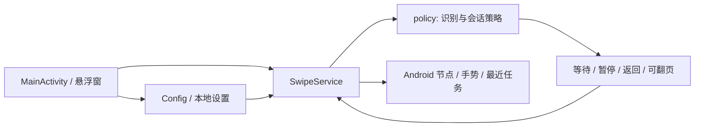

# 架构与职责

工程保留原 Java 与 Android View 实现，不引入额外运行时库。维护边界是把可独立验证的决策放进 `:policy`，把设备相关操作放进 `:app`。

## 模块边界

| 模块或入口 | 职责 | 边界 |
|---|---|---|
| `policy/src/main/java/com/local/swipepilot/` | `AdDetector`、`SwipePolicy`、`SessionPolicy`、`AdReturnPolicy`、`PopupPolicy` | 不导入 `android.*`；用输入、时间与状态作判断，不直接发手势或读设备 |
| `policy/src/test/java/com/local/swipepilot/` | JUnit 测试入口、原断言检查与广告等待问题复现 | 覆盖决策与时序，不声称第三方应用节点可用 |
| `app/.../MainActivity.java` | 应用选择、权限状态、配置、启动 | 面向老年人的操作入口，至少 48dp 点击区域 |
| `app/.../SwipeService.java` | 生命周期、前台确认、扫描、计时、浮窗、模式协调与动作执行 | 执行动作前复核目标前台和会话，取消过期任务 |
| `app/.../AccessState.java` | OFF / CONNECTING / READY 判断 | 系统授权列表与实际服务连接分别判断 |
| `app/.../ServiceDiagnostics.java` | 服务连接/解绑/销毁/中断、会话开始/结束、轮询异常的诊断 | 只写稳定事件代码与异常类名，不写异常消息、页面或目标应用 |
| `app/.../Config.java` | 按应用设置、默认值迁移、随机间隔 | 本地保存，不混入页面内容 |
| `app/.../TaobaoPopup.java` | Android 弹窗节点与明确关闭控件筛选 | 不用截图固定坐标，无法证明关闭节点时暂停 |
| `app/.../RecentTasks.java` | 最近任务中定位目标应用卡片 | 有限搜索，不清理任务、不重启目标应用 |
| `DemoActivity` / `DemoAdActivity` | 可控制的练习与广告模拟 | 演示证据独立于真实第三方应用证据 |

纯策略与 Android 适配类使用 `com.local.swipepilot` namespace。Debug 的 applicationId 带 `.debug` 后缀，Java namespace 与 applicationId 分别管理。

## 策略的输入与动作约束

广告识别接收单个可读取项目组成的列表。计时必须在明确广告/跳过格式里，不允许把全屏标签和别处数字拼接。无障碍覆盖层与输入法应在 Android 扫描层排除；纯解析测试不能证明这个过滤在真实系统上正确。

`SwipePolicy` 管理正常间隔、广告等待与误识别豁免；重复倒计时值不能不断延期。`SessionPolicy` 管理离开、锁屏、可选总时长；停止不能保留可自动恢复的动作。`AdReturnPolicy` 只推进广告预告到奖励完成的链路。`PopupPolicy` 独立管理 10 秒等待、最多两次关闭尝试与消失确认，不用普通广告等待代替弹窗状态。

Android 层使用同一单调时间来源驱动策略，不能把墙钟或服务回调次数当作经过时间。窗口、前台应用、锁屏或手动状态改变后，执行层须重新检查动作合法性；策略通过不等于点击当前窗口合法。

## 后续重构方向

`SwipeService` 仍集中较多 Android 协调代码。后续可在已有回归与真机基线支持下，分离前台观察、节点快照和动作调度；每次只迁移一个职责并保持两种模式和取消边界。不要先将全部系统逻辑搬入“通用策略”或为抽象增加依赖。

构建、版本和依赖入口见 [开发指南](development.md)，设备相关验收见 [真机验收](device-validation.md)。
